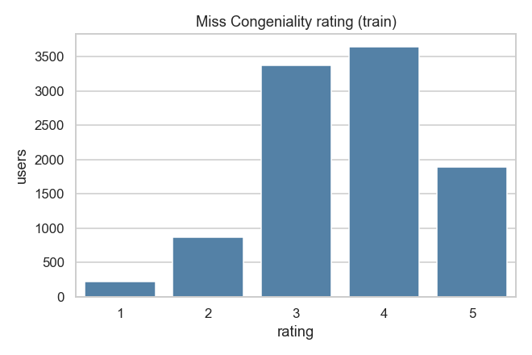
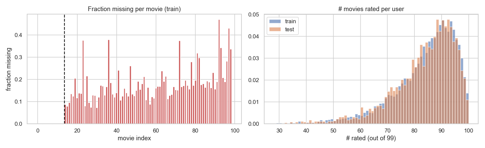
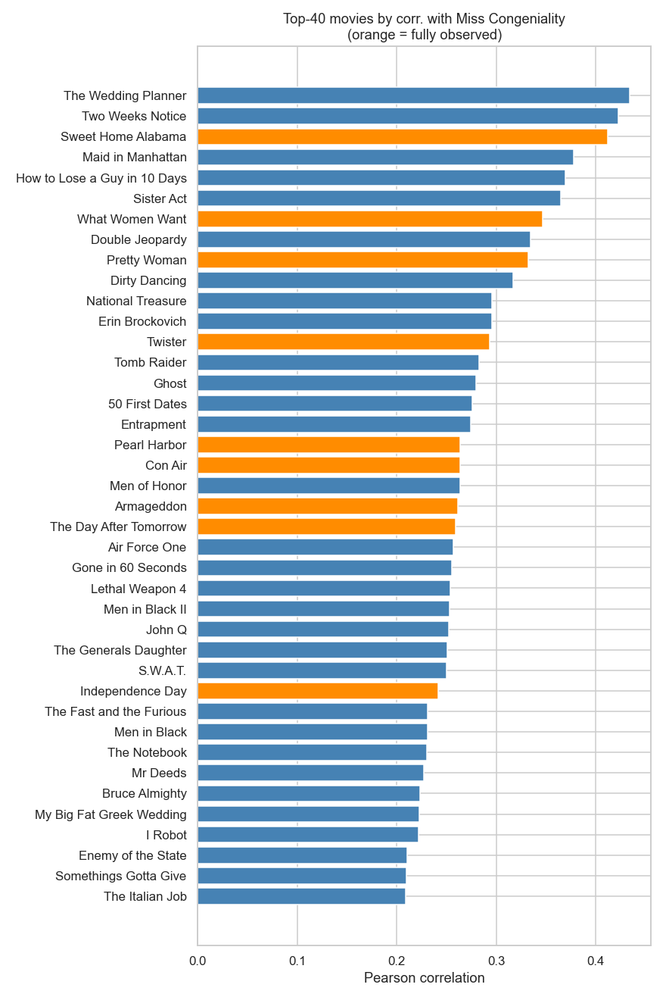
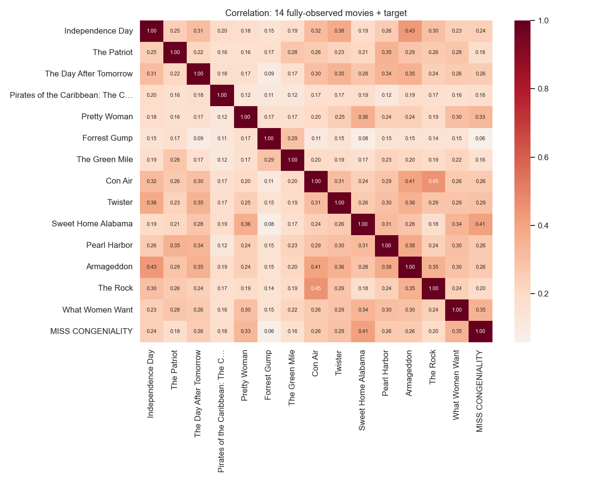
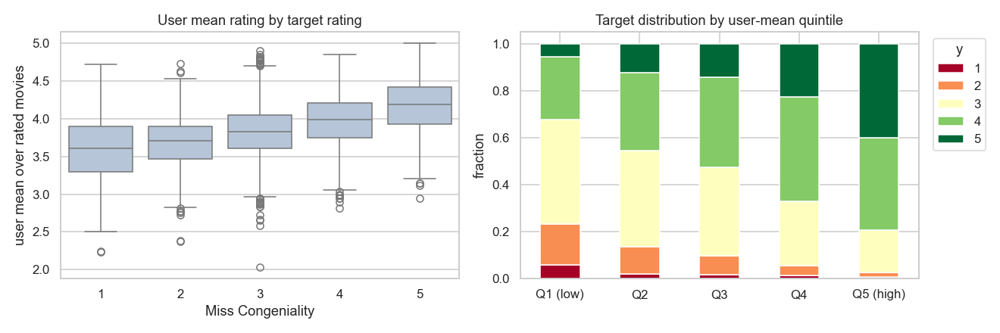
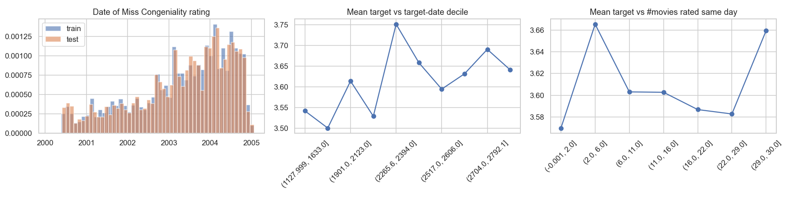
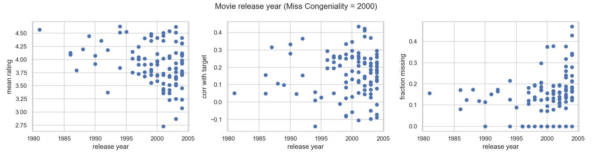
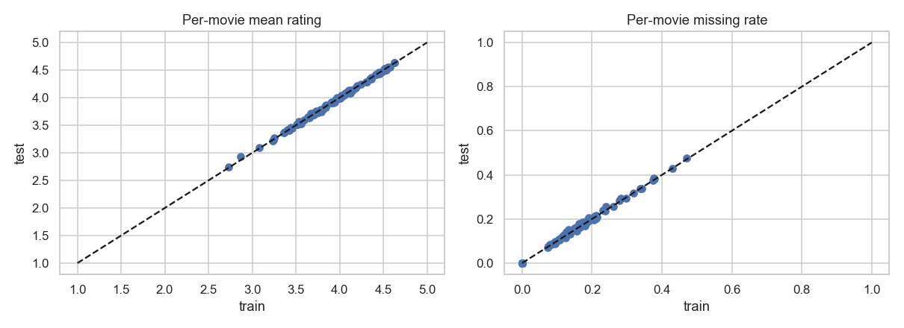

# EDA – Netflix Class Competition

Reproduce: `python netflix_competition/eda/eda.py` from the repo root.
All printed statistics are in [`eda_output.txt`](eda_output.txt), and all plots are in [`figures/`](figures/).

---

## 1. Data overview & sanity checks
| | Train | Test |
|---|---|---|
| Users | 10,000 | 2,931 |
| Movies (features) | 99 | 99 |
| Fully observed movies | first 14 | first 14 |
| Missing rate, movies 15–99 | 17.9% | 18.3% |
| # movies rated per user (mean / median / min) | 83.8 / 86 / 28 | 83.5 / 86 / 32 |

* A rating is missing **exactly** when its date is missing (consistent in both sets).
* The target and target dates have no missing values.
* Movie release years run from 1981 to 2004. Rating dates run from Dec 1998 to Jan 2005.

## 2. The target – "Miss Congeniality" (2000)

| rating | 1 | 2 | 3 | 4 | 5 |
|---|---|---|---|---|---|
| % | 2.1 | 8.7 | 33.8 | 36.5 | 19.0 |

* Mean = **3.615**, std = **0.9575**. This means the naive "predict the mean" RMSE is ≈ 0.957.
* Benchmarks: linear regression 0.7769 → bonus < **0.76** → double bonus < **0.745**.
* The distribution is skewed toward 3–4, and 1s are rare. Because the scale is ordinal, an ordinal or classification model with expected-value predictions might help.

## 3. Missingness is informative

* The most-missing movies are recent "indie/cult" titles (Sideways 47%, Napoleon Dynamite 43%, Royal Tenenbaums, Lost in Translation, Memento ≈ 37%).
* **Whether a user rated a movie predicts the target.** These are users who *did not* rate the movie:

| movie | y \| rated | y \| missing | corr(missing, y) |
|---|---|---|---|
| Sister Act | 3.69 | 3.27 | −0.17 |
| Maid in Manhattan | 3.69 | 3.29 | −0.17 |
| Two Weeks Notice | 3.67 | 3.21 | −0.16 |
| Memento | 3.50 | 3.81 | +0.16 |
| Fight Club | 3.52 | 3.84 | +0.15 |
| Pulp Fiction | 3.55 | 3.87 | +0.14 |

  Users who skip rom-coms dislike Miss Congeniality. Users who skip "arthouse" films like it more.
  → **Missing-indicator (dummy) features should go into the model**, not just imputation.

## 4. Which movies predict the target?

* The strongest predictors are **romantic comedies / chick-flicks**: The Wedding Planner (r=0.43), Two Weeks Notice (0.42), Sweet Home Alabama (0.41, fully observed), Maid in Manhattan (0.38), How to Lose a Guy in 10 Days (0.37), Sister Act (0.37), What Women Want (0.35, fully observed), Pretty Woman (0.33, fully observed).
* The most *negative* correlations are with "highbrow" films: Pulp Fiction (−0.14), Royal Tenenbaums (−0.10), Lost in Translation (−0.10), Sideways, American Beauty.
* Among the 14 fully observed movies, Forrest Gump (0.06) and The Green Mile (0.16) carry little signal.

## 5. User-level effects

* corr(user mean rating over the first 14 movies, y) = **0.46**. Over all rated movies it is 0.41.
* corr(user rating std, y) = −0.16.
* The user's overall rating level (the "user bias") is a major signal. Centering or normalizing ratings per user should be useful.

## 6. Dates

* The train and test target-date distributions are nearly identical (2000-06 → 2005-01).
* Raw date effects on the target are **weak** (|r| < 0.05). These include the target date, the user's activity span, and days since the first rating.
* **93% of users rated Miss Congeniality on the same day as at least one other movie** (median 16 movies that day). Also, the median user rated it within 5 days of their first rating.
* **Interesting interaction:** a movie rated on the *same day* as the target correlates more strongly with the target:

| movie | r (same day) | r (other days) |
|---|---|---|
| Sweet Home Alabama | 0.479 | 0.365 |
| The Wedding Planner | 0.468 | 0.396 |
| How to Lose a Guy… | 0.408 | 0.354 |

  → Date-proximity features (e.g. "same-day" indicators, or weighting by |date − target date|) may help.

## 7. Release year

* Newer movies have lower mean ratings (r = −0.29) and more missingness (r = +0.27).
* Release year does **not** predict how correlated a movie is with the target (r ≈ 0.02). It is probably useful only indirectly.

## 8. Train vs. test

The per-movie means (max diff 0.06), missing rates (max diff 0.02), user means, and target dates all match closely. Train and test look like a random split, so **cross-validation on train should reflect test performance well**.

---

## Takeaways for modeling (next steps)
1. Use all 99 movies. The best predictors (rom-coms) are partially missing, so handle missing values carefully: missing-indicator dummies plus imputation, or low-rank / matrix-factorization approaches.
2. Model the **user bias** (user mean/std) and consider per-user centered ratings.
3. Try date-based features, especially same-day interactions with the target date.
4. Consider ordinal/categorical treatment of ratings (e.g. one-hot encoding the predictor ratings).
5. Use K-fold CV on the 10k training users as the validation scheme.
